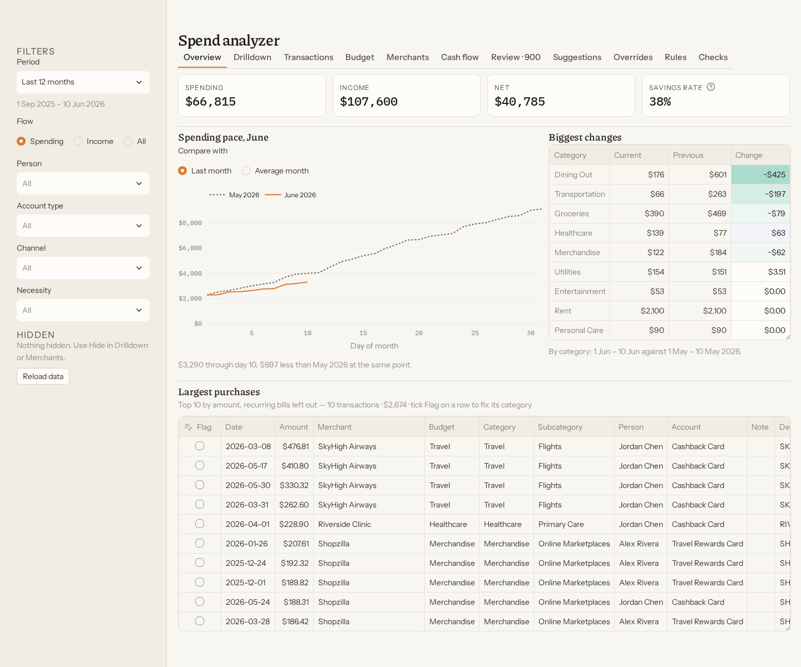
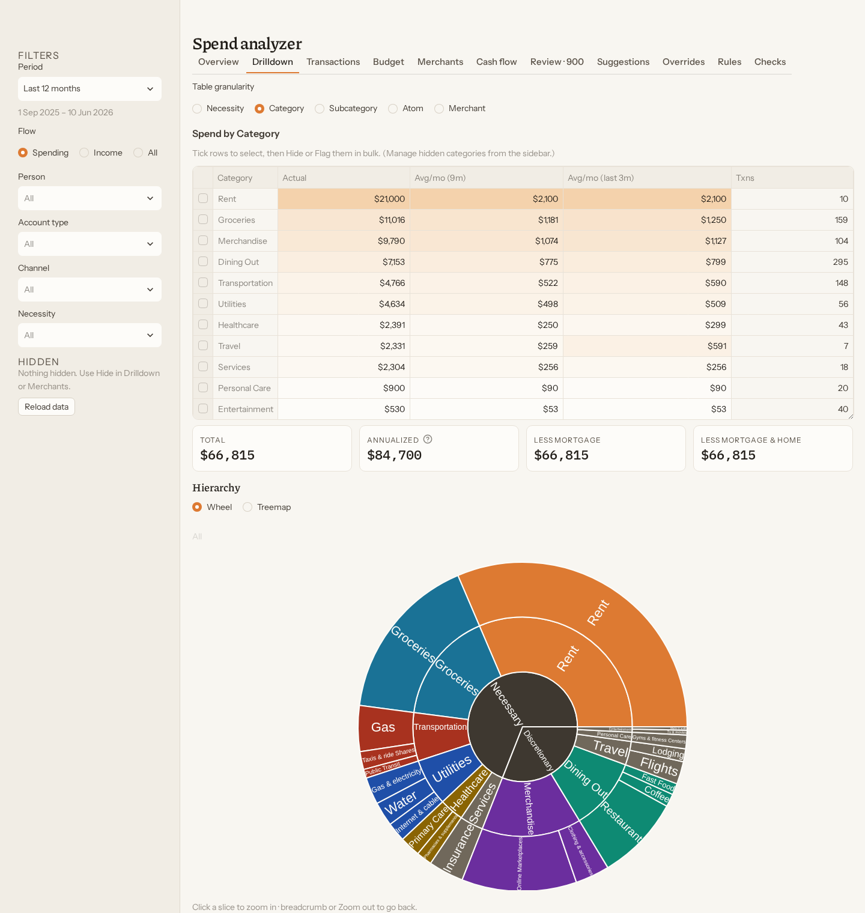
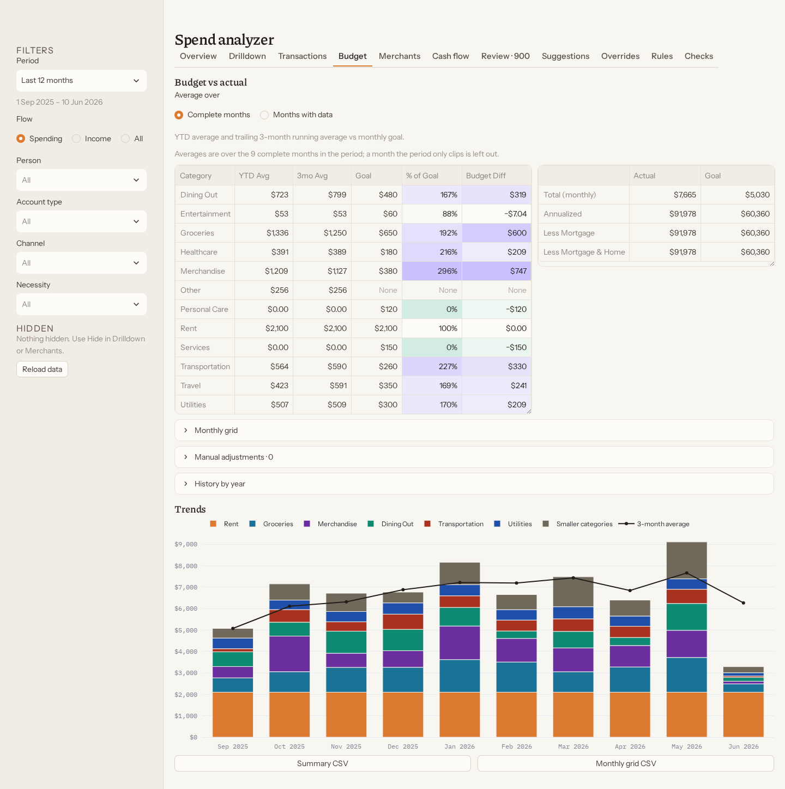
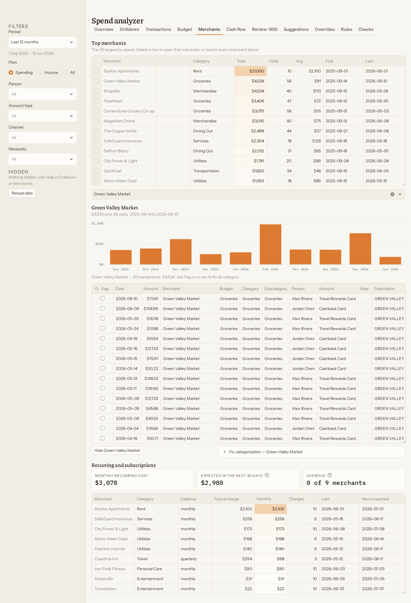
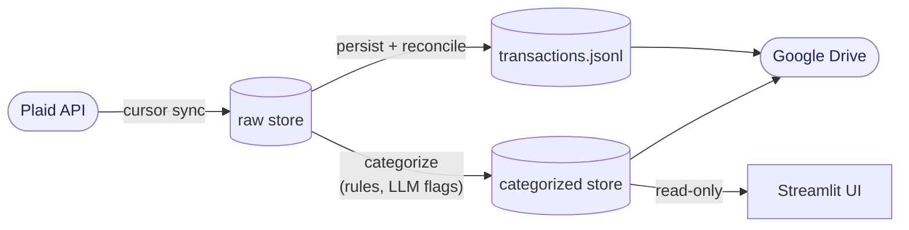

# spend_visualizer

[](https://github.com/ethanez713/spend_visualizer/actions/workflows/ci.yml)


**See where the money goes without handing your bank data to a budgeting service.** It
pulls transactions from your banks through Plaid, fixes their categories with rules you
control, and shows spending, budgets and cash flow in a local web app. The data stays on
your machine.

<table>
  <tr>
    <td width="50%" valign="top"><br><b>Overview.</b> Spending, income, net and savings rate, this month's pace against last, and the categories that moved most.</td>
    <td width="50%" valign="top"><br><b>Spending.</b> By necessity, category, subcategory or merchant, with a wheel that zooms on click and filters the transactions below it.</td>
  </tr>
  <tr>
    <td width="50%" valign="top"><br><b>Budget.</b> Each category against its monthly goal, as a year-to-date and trailing three-month average.</td>
    <td width="50%" valign="top"><br><b>Merchants.</b> The largest merchants, one merchant's history, and recurring charges with their next expected date.</td>
  </tr>
</table>

Every figure is synthetic: invented people, banks and merchants from
[`gen_demo_data.py`](spend_analyzer/tools/gen_demo_data.py). More views (cash flow, the
review queue, rules, pipeline checks) are in [`docs/img/`](docs/img).

## Try it with demo data

No bank account or Plaid key needed:

```bash
cd spend_analyzer
python3 -m venv venv && ./venv/bin/pip install --require-hashes -r requirements.lock.txt
./venv/bin/python -m tools.gen_demo_data            # prints SPEND_VISUALIZER_DATA=<a temp dir>
SPEND_VISUALIZER_DATA=<that dir> ./venv/bin/streamlit run app.py
```

## What it does

- **Syncs incrementally.** Cursor-based Plaid sync with a 90-day re-fetch as a safety net,
  so a late correction from the bank is picked up on the next run.
- **Never loses history.** Stores are append-only. Plaid is treated as the source of
  truth for what it returns, but a row that ages out of the API is kept, and a conflict
  stops the run before anything is written.
- **Categorizes with rules first.** Deterministic rules overwrite; an optional local LLM
  only flags rows for review; your manual corrections are the highest authority and are
  replayed on every run.
- **Handles a household.** Every transaction is stamped with the person whose bank link
  produced it, and every view can be filtered by person.
- **Works offline.** The core path makes no network calls. Plaid, Google Drive backup and
  the LLM are each opt-in.

## How it is put together



| Directory | Role |
|---|---|
| `finance_pipeline/` | Orchestrator — runs the components below in sequence, each under its own venv |
| `transactions/` | Plaid collector — incremental sync into a durable, Drive-replicated store |
| `persister/` | Shared library — durable, deduped, reconciled, Drive-synced JSONL stores |
| `plaid_category_transformer/` | Category auditor — deterministic rules + Claude-ritual review (flag-don't-overwrite; local LLM off by default) |
| `spend_analyzer/` | Streamlit UI — faceted spending analysis over the categorized archive |
| `deploy/` | Server artifacts — systemd units + runbook to run the stack as an unattended service |

Components locate each other by sibling-relative paths; don't rename the directories
independently. Each component has its own README with full details, and its own venv.

Code lives in this repo and **all personal data lives outside it**, under a data root you
choose; credentials stay in gitignored `.secrets/` directories. Dependencies are pinned
and hash-locked per component, and CSV output is escaped against formula injection.

The local LLM reviewer was measured before it was trusted:
[`LLM_ASSESSMENT.md`](LLM_ASSESSMENT.md) puts its flag precision at 23%, traces that to
one misread sign convention, and is why it only ever flags.

## Using it for real

- [docs/SETUP.md](docs/SETUP.md): environments, a Plaid account, optional Drive sync,
  linking banks, tests.
- [docs/USAGE.md](docs/USAGE.md): the everyday loop, every command, and running it as a
  scheduled service.
- [`CLAUDE.md`](CLAUDE.md): the invariants and conventions, written for AI agents working
  in the repo.

## License

MIT. Copyright (c) 2026 Ethan Zhou. See [LICENSE](LICENSE).

IBM Plex Mono, Instrument Sans and Piazzolla, the fonts in
`spend_analyzer/static/fonts/`, are under the SIL Open Font License 1.1. Their
license texts are in `THIRD_PARTY_LICENSES/`.
